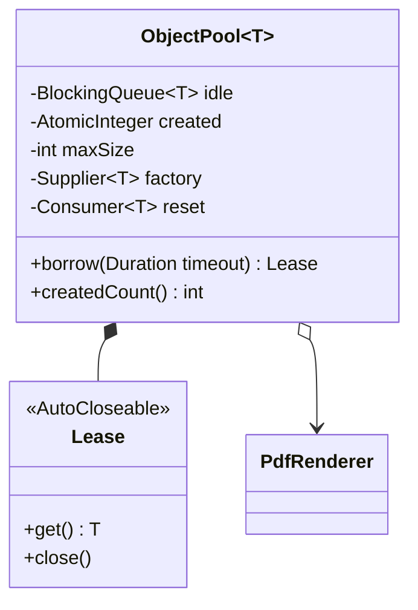

# Object Pool (Nesne Havuzu)

> 🇬🇧 [English](../../en/enterprise/object-pool.md) · **Kategori:** Oluşturucu (Creational) · **Kod:** [`enterprise/objectpool`](../../../src/main/java/designpatterns/enterprise/objectpool)

## Amaç

**Oluşturması pahalı** olan sınırlı sayıda nesneyi her istekte yaratıp yok etmek yerine **tekrar kullanmak**.
İstemciler bir nesneyi ödünç alır, işi bitince geri verir.

## Problem

Bir veritabanı bağlantısı, TLS oturumu ya da PDF render motoru oluşturmak yüzlerce milisaniye ve çok bellek
alır. Her istekte bir tane oluşturmak yavaştır; trafik patladığında binlercesi veritabanını ya da JVM'i çökertir.

## Çözüm

Havuz nesneleri ihtiyaç oldukça (lazy) `maxSize`'a kadar oluşturur. `borrow` boştaki bir nesneyi verir,
limit izin veriyorsa yenisini oluşturur ya da (timeout ile) **bekler**. Geri verilen nesnenin durumu
**sıfırlanır** ve havuza döner. Ödünç nesneyi `AutoCloseable` bir *lease*'e sarmak, geri vermeyi unutmayı
imkansız kılar.



| Rol | Sınıf |
|---|---|
| Havuz | [`ObjectPool<T>`](../../../src/main/java/designpatterns/enterprise/objectpool/ObjectPool.java) |
| Tekrar kullanılan nesne | [`PdfRenderer`](../../../src/main/java/designpatterns/enterprise/objectpool/PdfRenderer.java) |
| İstemci | try-with-resources bloğu |

```java
try (var lease = pool.borrow(Duration.ofSeconds(1))) {
    lease.get().render("invoice.pdf");
}   // otomatik olarak havuza döner
```

Örnekte 50 virtual thread **3** renderer'ı paylaşıyor.

Örnek: [`ObjectPoolDemo.java`](../../../src/main/java/designpatterns/enterprise/objectpool/ObjectPoolDemo.java)

## Ne zaman kullanılır?

- Nesneler hem pahalıysa **hem de** sayılarını sınırlamak gerekiyorsa (bağlantılar, soketler, native kaynaklar).
- Sıradan nesneler için **değil**: JVM kısa ömürlü nesneleri çok hızlı oluşturur ve toplar; onları havuzlamak
  işleri yavaşlatır ve hatalara (kullanıcılar arasında durum sızması) yol açar.
- Virtual thread'lerle birlikte *thread*'leri havuzlamaya gerek kalmadı; eşzamanlılığı `Semaphore` ile sınırlayın.

## Artıları ve eksileri

| ✅ Artıları | ❌ Eksileri |
|---|---|
| Tekrar tekrar pahalı oluşturmayı önler | Geri verilmeyen nesne sızar |
| Kaynak kullanımına üst sınır koyar | Durum sıfırlanmalı; kirli nesneler zor hatalar doğurur |
| Trafik patlamalarını yumuşatır (istemciler bekler) | Thread güvenliği ve boyutlandırma zordur |

## Gerçek dünyadan örnekler

- Veritabanı bağlantı havuzları: **HikariCP** (Spring Boot varsayılanı), Apache DBCP, c3p0
- `ThreadPoolExecutor` / `Executors.newFixedThreadPool` – thread havuzu
- Apache Commons Pool, Netty `PooledByteBufAllocator`, HTTP client bağlantı havuzları

## İlişkili kalıplar

- **Singleton** – havuzun kendisi genelde tek bir paylaşılan örnektir.
- **Flyweight** – o da nesne paylaşır ama flyweight'ler değişmezdir ve *aynı anda* paylaşılır; havuzdaki
  nesneler değişebilirdir ve *aynı anda tek bir istemci* kullanır.
- **Factory Method** – havuz nesneleri oluşturmak için bir fabrika (`Supplier<T>`) kullanır.
