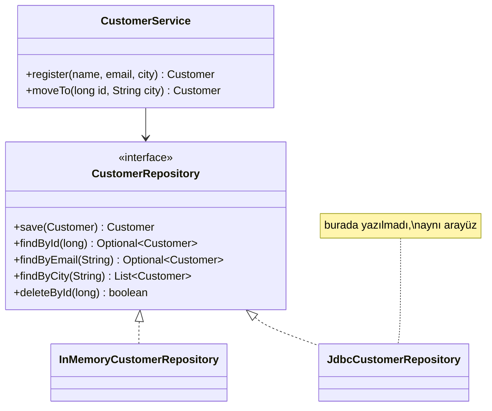

# Repository (Depo)

> 🇬🇧 [English](../../en/enterprise/repository.md) · **Kategori:** Kurumsal (Martin Fowler, *PoEAA* / Eric Evans, *DDD*) · **Kod:** [`enterprise/repository`](../../../src/main/java/designpatterns/enterprise/repository)

## Amaç

Domain ile veri eşleme katmanları arasında, domain nesnelerine **koleksiyon benzeri bir arayüzle** erişim
sağlayan bir aracı olmak. İş kodu *"bu SQL'i çalıştır"* değil, *"İstanbul'daki müşterileri ver"* der.

## Problem

SQL string'leri, JDBC kodu, ORM çağrıları ve cache mantığı servislerin içine dağılır. Depolamayı değiştirmek
(PostgreSQL → MongoDB, cache eklemek) iş kodunu etkiler ve iş kurallarını test etmek için veritabanı gerekir.

## Çözüm

Domain terimleriyle bir arayüz tanımlayın (`save`, `findById`, `findByCity`). İş servisleri sadece bu
arayüze bağımlıdır; bir ya da birkaç sınıf onu belirli bir depolama teknolojisi için gerçekleştirir.

| Rol | Sınıf |
|---|---|
| Domain nesnesi | [`Customer`](../../../src/main/java/designpatterns/enterprise/repository/Customer.java) |
| Repository | [`CustomerRepository`](../../../src/main/java/designpatterns/enterprise/repository/CustomerRepository.java) |
| Gerçekleştirme | [`InMemoryCustomerRepository`](../../../src/main/java/designpatterns/enterprise/repository/InMemoryCustomerRepository.java) |
| İstemci | [`CustomerService`](../../../src/main/java/designpatterns/enterprise/repository/CustomerService.java) |

Örnek: [`RepositoryDemo.java`](../../../src/main/java/designpatterns/enterprise/repository/RepositoryDemo.java)

## Ne zaman kullanılır?

- Gerçek iş mantığı olan uygulamalarda (DDD, katmanlı ya da hexagonal mimari).
- Domain'i bellek içi (in-memory) bir repository ile birim test etmek istiyorsanız.
- Genelde **her aggregate root için bir repository** (`OrderRepository` evet, `OrderLineRepository` hayır).

## Artıları ve eksileri

| ✅ Artıları | ❌ Eksileri |
|---|---|
| İş kodu depolamadan bağımsız | Basit CRUD uygulamalarında fazladan katman |
| Bellek içi sahte nesnelerle kolay test | 40 metotlu generic `Repository<T>`'ler depolama detayını sızdırır |
| Sorgular ve cache için merkezi yer | Veritabanını tamamen gizlemek N+1 ve yavaş sorgulara yol açabilir |

## Gerçek dünyadan örnekler

- Spring Data: `interface CustomerRepository extends JpaRepository<Customer, Long>` – gerçekleştirme
  `findByCity` gibi metot adlarından üretilir.
- Jakarta Data (`@Repository`), Micronaut Data, Quarkus Panache

## İlişkili kalıplar

- **DAO** – tablo/teknoloji odaklıdır (`CustomerDao.insert`). Repository domain odaklıdır ve koleksiyona
  daha yakındır. Pratikte isimler sıkça karıştırılır.
- **Specification** – `findByXAndYAndZ` metotları eklemek yerine bir specification verilir.
- **Unit of Work** – değişiklikleri izler ve birlikte commit eder (JPA `EntityManager`).
- **Dependency Injection** – servis repository'yi dışarıdan alır.
