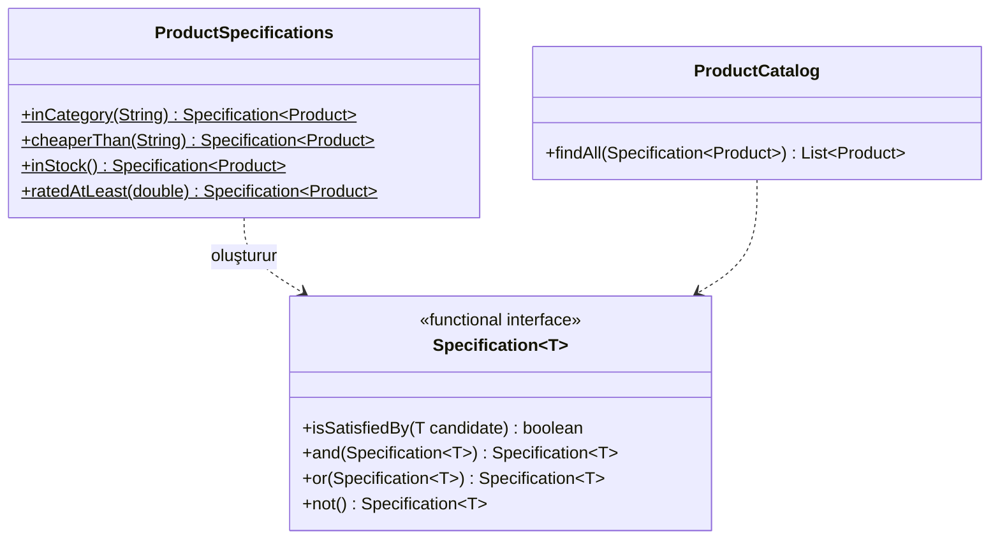

# Specification (Şartname)

> 🇬🇧 [English](../../en/enterprise/specification.md) · **Kategori:** Kurumsal (Eric Evans & Martin Fowler) · **Kod:** [`enterprise/specification`](../../../src/main/java/designpatterns/enterprise/specification)

## Amaç

Bir **iş kuralını**, *"bu aday beni sağlıyor mu?"* sorusunu cevaplayan ve diğer kurallarla `and`, `or`,
`not` kullanılarak **birleştirilebilen** bir nesneye sarmak.

## Problem

Ürün aramasında filtreler var: kategori, fiyat, stok, puan... Repository'de
`findByCategoryAndPriceLessThanAndStockGreaterThan` gibi metotlar birikir ve aynı kural ("stokta var")
doğrulama, arama ve raporlama kodlarına kopyalanır.

## Çözüm

Her kural küçük bir nesnedir (burada bir functional interface, yani lambda). Default metotlar bileşik
kurallar üretir. Tek bir generic arama metodu her specification'ı kabul eder.



| Rol | Sınıf |
|---|---|
| Specification | [`Specification<T>`](../../../src/main/java/designpatterns/enterprise/specification/Specification.java) |
| Somut specification'lar | [`ProductSpecifications`](../../../src/main/java/designpatterns/enterprise/specification/ProductSpecifications.java) |
| Bileşik specification'lar | `and` / `or` / `not` default metotları |
| İstemci | [`ProductCatalog`](../../../src/main/java/designpatterns/enterprise/specification/ProductCatalog.java) |

```java
var cheapElectronics = inCategory("electronics").and(cheaperThan("500"));
var soldOutBooks     = inCategory("books").and(inStock().not());
catalog.findAll(cheapElectronics);
```

Örnek: [`SpecificationDemo.java`](../../../src/main/java/designpatterns/enterprise/specification/SpecificationDemo.java)

Önce / sonra: [refactoring örneği](../refactoring.md#specification)

## Ne zaman kullanılır?

- Birleştirilebilen çok sayıda filtreleme ya da doğrulama kuralı varsa.
- Aynı kural bellek içi kontrolde, veritabanı sorgusunda ve doğrulamada kullanılıyorsa.
- Basit ve sabit filtreler için düz bir `Predicate` ya da arama metodu yeterlidir.

## Artıları ve eksileri

| ✅ Artıları | ❌ Eksileri |
|---|---|
| Kuralların adı var ve tekrar kullanılabilir | Bellek içi filtreleme ölçeklenmez; veritabanı için sorguya çevrilmeli |
| Yeni metot eklemeden kuralları birleştirme | Basit durumlarda fazladan soyutlama |
| Her kural ayrı birim test edilebilir | |

## Gerçek dünyadan örnekler

- `and` / `or` / `negate` metotlarıyla `java.util.function.Predicate`, JDK'daki aynı fikirdir.
- Spring Data JPA `Specification<T>` + `JpaSpecificationExecutor` – kurallar SQL `WHERE` ifadesine dönüşür.
- QueryDSL / JPA Criteria predicate'leri

## İlişkili kalıplar

- **Composite** – `and`/`or`/`not` bir specification ağacı kurar.
- **Interpreter** – specification ağacı küçük bir boolean dilidir.
- **Repository** – çok sayıda arama metodu yerine specification kabul eder.
- **Strategy** – specification, boolean döndüren bir stratejidir.
