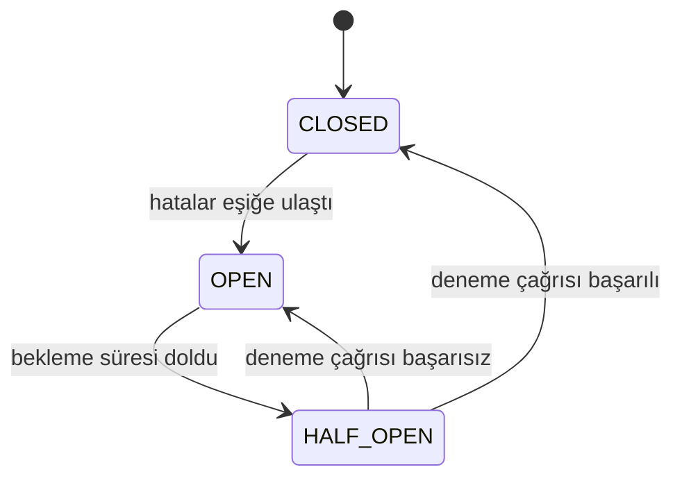

# Circuit Breaker (Devre Kesici)

> 🇬🇧 [English](../../en/microservice/circuit-breaker.md) · **Kategori:** Mikroservis / dayanıklılık (Michael Nygard, *Release It!*) · **Kod:** [`microservice/circuitbreaker`](../../../src/main/java/designpatterns/microservice/circuitbreaker)

## Amaç

Sürekli hata veren bir uzak servisi çağırmayı bırakmak, bir süre **hızlıca hata dönmek** (fail fast) ve
servisin toparlanmasına izin vermek; sonra dikkatlice tekrar denemek. Evinizdeki sigorta gibi.

## Problem

Döviz kuru servisi çöktü. Servisimize gelen her istek 30 saniyelik timeout'u bekliyor, thread'ler birikiyor,
servisimizin kaynakları tükeniyor ve o da çöküyor – **zincirleme çöküş** (cascading failure). Bu arada
zorlanan servisi retry'larla dövmeye devam ettiğimiz için o da toparlanamıyor.

## Çözüm

Uzak çağrıyı bir durum makinesiyle sarın:



- **CLOSED** (kapalı) – normal. Çağrılar geçer; art arda gelen hatalar sayılır.
- **OPEN** (açık) – çağrılar anında reddedilir (`CallNotPermittedException`) ya da bir **fallback**
  döndürülür (cache'teki değer, varsayılan, "sonra deneyin" mesajı). Uzak servise dokunulmaz.
- **HALF_OPEN** (yarı açık) – bekleme sonrası tek bir deneme çağrısı devrenin kapanıp kapanmayacağına karar verir.

| Rol | Sınıf |
|---|---|
| Devre kesici | [`CircuitBreaker`](../../../src/main/java/designpatterns/microservice/circuitbreaker/CircuitBreaker.java) |
| Korunan uzak çağrı | [`ExchangeRateClient`](../../../src/main/java/designpatterns/microservice/circuitbreaker/ExchangeRateClient.java) |
| Reddetme | [`CallNotPermittedException`](../../../src/main/java/designpatterns/microservice/circuitbreaker/CallNotPermittedException.java) |
| Zaman kaynağı | [`ManualClock`](../../../src/main/java/designpatterns/common/ManualClock.java) – örnek ve testler 30 sn'yi anında "bekler" |

```java
BigDecimal rate = breaker.call(client::usdToTry, () -> cachedRate);
```

Örnekte servis çökükken 6 çağrı yapılıyor ama sadece 3'ü servise ulaşıyor; geri kalanı fallback ile
anında cevaplanıyor.

Örnek: [`CircuitBreakerDemo.java`](../../../src/main/java/designpatterns/microservice/circuitbreaker/CircuitBreakerDemo.java)

## Ne zaman kullanılır?

- Yavaşlayabilecek ya da çökebilecek başka bir servise, veritabanına ya da üçüncü parti API'ye yapılan her
  senkron çağrıda.
- **Timeout** (her zaman), **backoff'lu retry** (kısa aksaklıklar için) ve **bulkhead** (bağımlılık başına
  eşzamanlı çağrı sınırı) ile birlikte kullanın.

## Artıları ve eksileri

| ✅ Artıları | ❌ Eksileri |
|---|---|
| Zincirleme çöküşleri önler | Eşik ve sürelerin ayarlanması gerekir |
| Çöken servise toparlanma zamanı verir | Fallback mantığı iş açısından anlamlı olmalı |
| Uzun timeout yerine fallback ile hızlı cevap | Durum her instance'ta ayrı: her replika kendi başına açılır |

## Gerçek dünyadan örnekler

- **Resilience4j** (`@CircuitBreaker(name = "rates", fallbackMethod = "cachedRate")`), Spring Cloud Circuit Breaker
- Netflix Hystrix (emekli, kalıbı popüler yapan), Istio / Envoy outlier detection, Polly (.NET)

## İlişkili kalıplar

- **Proxy** – devre kesici, uzak servisin önündeki bir proxy'dir.
- **State** – CLOSED / OPEN / HALF_OPEN ders kitabı niteliğinde bir durum makinesidir.
- **Retry, Timeout, Bulkhead, Rate Limiter** – genelde birlikte kullanılan diğer dayanıklılık kalıpları.
