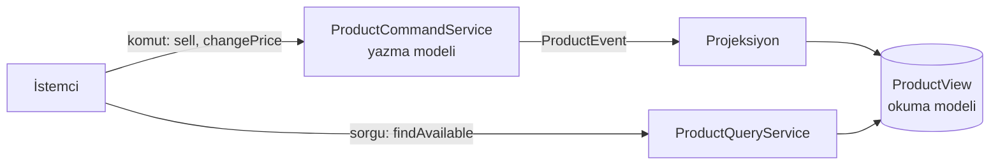

# CQRS (Komut ve Sorgu Sorumluluklarının Ayrılması)

> 🇬🇧 [English](../../en/microservice/cqrs.md) · **Kategori:** Mimari (Greg Young, Bertrand Meyer'in CQS ilkesine dayanır) · **Kod:** [`microservice/cqrs`](../../../src/main/java/designpatterns/microservice/cqrs)

## Amaç

**Yazma ve okuma için farklı modeller** kullanmak. Komutlar durumu değiştirir ve iş kurallarını uygular;
sorgular ise ekranlara göre şekillenmiş, olaylarla güncel tutulan ayrı bir modelden okur.

## Problem

Tek bir `Product` entity'si her şeye hizmet ediyor: güncellemelerdeki doğrulama, ürün listeleme sayfaları,
arama, yönetici raporları. Okumalar join, denormalize alanlar ve farklı index'ler ister; yazmalar tutarlılık
ve kural ister. Model, hiçbirinde iyi olmayan bir uzlaşmaya dönüşür. Okumalar çoğu zaman yazmalardan 100 kat
fazladır ama ikisi birlikte ölçeklenir.

## Çözüm

- **Komut tarafı** – doğrular (`price > 0`, `stock >= 0`), yazma modelini değiştirir, olay yayınlar.
  Komutlar bir şey döndürmez (ya da sadece bir id döndürür).
- **Sorgu tarafı** – bir *projeksiyon* olayları dinler ve `ProductView` satırlarını gösterime hazır tutar
  (`"Wireless mouse – 450.00 TL (sold out)"`). Sorgular asla durumu değiştirmez.

| Rol | Sınıf |
|---|---|
| Komut tarafı / yazma modeli | [`ProductCommandService`](../../../src/main/java/designpatterns/microservice/cqrs/ProductCommandService.java) |
| Olaylar | [`ProductEvent`](../../../src/main/java/designpatterns/microservice/cqrs/ProductEvent.java) (sealed interface + record'lar) |
| Projeksiyon / sorgu tarafı | [`ProductQueryService`](../../../src/main/java/designpatterns/microservice/cqrs/ProductQueryService.java) |
| Okuma modeli | [`ProductView`](../../../src/main/java/designpatterns/microservice/cqrs/ProductView.java) |

Projeksiyon, sealed olay hiyerarşisi üzerinde **`switch` ile pattern matching** kullanır: yeni bir olay
tipini ele almadan eklemek derleme hatası verir.

Örnek: [`CqrsDemo.java`](../../../src/main/java/designpatterns/microservice/cqrs/CqrsDemo.java)

## Bilinmesi gerekenler

- Burada olaylar senkron dağıtılıyor. Production'da okuma modeli çoğu zaman başka bir depodadır
  (Elasticsearch, Redis, read replica) ve asenkron güncellenir → **nihai tutarlılık**: kullanıcı kendi
  değişikliğini bir anlığına göremeyebilir.
- CQRS, Event Sourcing ya da mikroservis **gerektirmez**; tek bir uygulamada ayrı okuma/yazma sınıfları
  kadar basit olabilir.

## Ne zaman kullanılır?

- Okuma ve yazma yükleri çok farklıysa (ölçek, şekil, depolama).
- Aynı verinin farklı görünümlerine ihtiyaç duyan çok ekranlı karmaşık domain'lerde.
- Basit CRUD için **değil**: modeli ikiye katlar ve tutarlılık problemleri ekler.

## Artıları ve eksileri

| ✅ Artıları | ❌ Eksileri |
|---|---|
| Her taraf bağımsız optimize edilir ve ölçeklenir | Daha fazla kod ve hareketli parça |
| Denormalize veri üzerinde basit, hızlı sorgular | Taraflar arasında nihai tutarlılık |
| Yazma modeli iş kurallarına odaklanır | Projeksiyonlar değişince yeniden oluşturulmalı |

## Gerçek dünyadan örnekler

- Axon Framework, EventStoreDB, Lagom; ayrı okuma repository'leriyle Spring Data
- PostgreSQL'de read replica + materialized view "hafif CQRS"tir

## İlişkili kalıplar

- **Event Sourcing** – olayları doğruluk kaynağı olarak saklar; projeksiyonlar okuma modellerini kurar (CQRS ile sık eşleşir).
- **Observer** – projeksiyon yazma tarafını gözlemler.
- **Transactional Outbox** – yazma tarafının olaylarını güvenilir şekilde yayınlar.
- **Mediator** – MediatR / Axon gibi kütüphaneler komut ve sorguları handler'lara yönlendirir.
