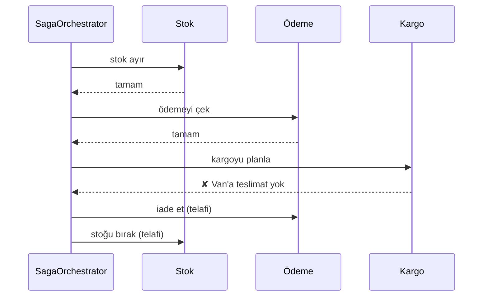

# Saga

> 🇬🇧 [English](../../en/microservice/saga.md) · **Kategori:** Mikroservis / veri tutarlılığı (Garcia-Molina & Salem, 1987; Chris Richardson) · **Kod:** [`microservice/saga`](../../../src/main/java/designpatterns/microservice/saga)

## Amaç

Servisler arasında veriyi **dağıtık transaction olmadan** tutarlı tutmak: iş transaction'ını bir dizi yerel
transaction'a bölmek ve biri başarısız olursa önceki adımları geri alan **telafi (compensating)
transaction'larını** çalıştırmak.

## Problem

Sipariş vermek, her birinin kendi veritabanı olan üç servis gerektiriyor: stok (ürünü ayır), ödeme (karttan
çek) ve kargo (teslimatı planla). Bunların hepsini kapsayan tek bir `BEGIN ... COMMIT` yok. İki aşamalı
commit (2PC) kaynakları kilitler, tüm katılımcıların desteklemesini gerektirir ve HTTP/mesajlaşma tabanlı
mikroservislere uymaz.

## Çözüm

Her adımın bir aksiyonu ve bir telafisi vardır. Orkestratör aksiyonları sırayla çalıştırır; biri başarısız
olursa tamamlanmış adımların telafilerini **ters sırada** çalıştırır.

| Rol | Sınıf |
|---|---|
| Adım (aksiyon + telafi) | [`SagaStep`](../../../src/main/java/designpatterns/microservice/saga/SagaStep.java) |
| Orkestratör | [`SagaOrchestrator`](../../../src/main/java/designpatterns/microservice/saga/SagaOrchestrator.java) |
| Saga tanımı | [`PlaceOrderSaga`](../../../src/main/java/designpatterns/microservice/saga/PlaceOrderSaga.java) |
| Katılımcılar | [`InventoryService`](../../../src/main/java/designpatterns/microservice/saga/InventoryService.java), [`PaymentService`](../../../src/main/java/designpatterns/microservice/saga/PaymentService.java), [`ShippingService`](../../../src/main/java/designpatterns/microservice/saga/ShippingService.java) |

Örnek: [`SagaDemo.java`](../../../src/main/java/designpatterns/microservice/saga/SagaDemo.java)

### Orkestrasyon mu koreografi mi?

| | Orkestrasyon (bu örnek) | Koreografi |
|---|---|---|
| Sonraki adıma kim karar verir | Merkezi bir orkestratör | Her servis olaylara tepki verir (`StockReserved` → ödeme...) |
| Görünürlük | Akış tek bir yerde | Akış servislere dağılmış |
| Bağlılık | Orkestratör tüm katılımcıları bilir | Servisler sadece olayları bilir |
| Uygun olduğu yer | Çok adımlı karmaşık akışlar | 2-3 adımlı basit akışlar |

## Bilinmesi gerekenler

- Telafi bir rollback değil, **anlamsal geri almadır** (iade, iptal); ara durum bir süre başkalarına görünür
  (izolasyon yok). Bunu yönetmek için "beklemede" durumları (`ORDER_PENDING`) kullanın.
- Adımlar ve telafiler **idempotent** ve tekrar denenebilir olmalı: mesajlar iki kez gelebilir.
- Bazı adımlar telafi edilemez (e-posta gönderildi). Onları **en sona** koyun ("pivot" adımı).

## Artıları ve eksileri

| ✅ Artıları | ❌ Eksileri |
|---|---|
| 2PC / dağıtık kilit olmadan tutarlılık | Tasarlamak, test etmek ve debug etmek daha zor |
| Her servis kendi veritabanını korur | Nihai tutarlılık (eventual consistency); izolasyon yok |
| HTTP ve mesajlaşma üzerinde çalışır | Her adım için bir telafi gerekir |

## Gerçek dünyadan örnekler

- Temporal, Camunda / Zeebe, Netflix Conductor, AWS Step Functions (orkestrasyon)
- Axon Framework saga'ları, Eventuate Tram Sagas, Kafka tabanlı koreografi

## İlişkili kalıplar

- **Transactional Outbox** – adımlar olaylarını onunla güvenilir şekilde yayınlar.
- **Command** – geri alma işlemiyle birlikte her adım `execute`/`undo` olan bir komuttur.
- **Memento** – önceki bir duruma dönmenin başka bir yolu, ama sadece tek bir process içinde.
- **CQRS / Event Sourcing** – olay güdümlü sistemlerde sıkça birlikte kullanılır.
