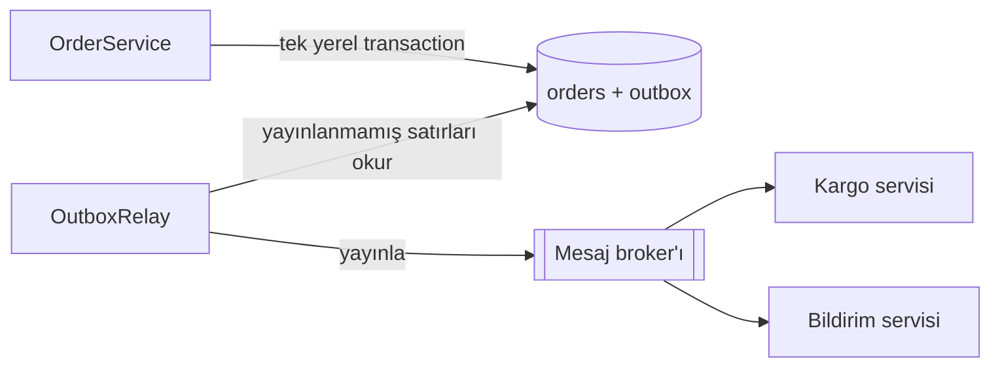

# Transactional Outbox (İşlemsel Giden Kutusu)

> 🇬🇧 [English](../../en/microservice/transactional-outbox.md) · **Kategori:** Mikroservis / mesajlaşma (Chris Richardson) · **Kod:** [`microservice/outbox`](../../../src/main/java/designpatterns/microservice/outbox)

## Amaç

Veritabanını güncellemek **ve** bir olayı **güvenilir şekilde** yayınlamak, hem de dağıtık transaction
olmadan: olayı iş verisiyle **aynı yerel transaction** içinde bir *outbox* tablosuna yazmak ve sonra yayınlamak.

## Problem — çift yazma (dual write)

```java
orderRepository.save(order);                 // 1. veritabanı
kafka.send("OrderPlaced", order);            // 2. broker
```

- 1. adımdan sonra broker çökük → sipariş kaydedildi, **olay kayboldu**; kargo servisi hiç haberdar olmuyor.
- Önce yayınla, sonra DB commit'i başarısız olsun → **var olmayan** bir sipariş için olay yayınlandı.
- Veritabanı ile broker tek bir ACID transaction'ı paylaşamaz.

## Çözüm



1. `OrderService` siparişi ve bir `OutboxMessage` satırını **tek** transaction'da ekler – ya ikisi ya hiçbiri.
2. Ayrı bir **relay** yayınlanmamış satırları okur, yayınlar ve yayınlandı olarak işaretler.
3. Broker çökükse satırlar sadece bekler; relay bir sonraki çalışmada tekrar dener.

| Rol | Sınıf |
|---|---|
| İş servisi | [`OrderService`](../../../src/main/java/designpatterns/microservice/outbox/OrderService.java) |
| Yerel transaction'lı veritabanı | [`Database`](../../../src/main/java/designpatterns/microservice/outbox/Database.java) |
| Outbox satırı | [`OutboxMessage`](../../../src/main/java/designpatterns/microservice/outbox/OutboxMessage.java) |
| Mesaj aktarıcı (relay) | [`OutboxRelay`](../../../src/main/java/designpatterns/microservice/outbox/OutboxRelay.java) |
| Broker | [`MessageBroker`](../../../src/main/java/designpatterns/microservice/outbox/MessageBroker.java) |

Örnek: [`OutboxDemo.java`](../../../src/main/java/designpatterns/microservice/outbox/OutboxDemo.java)

## Bilinmesi gerekenler

- Teslimat **en az bir kez**dir (at-least-once): relay yayınladıktan sonra ama satırı işaretlemeden önce
  çökebilir, olay tekrar gönderilir. Tüketiciler **idempotent** olmalı (ör. işlenmiş olay id'lerini
  saklamak – *Inbox* kalıbı).
- Relay seçenekleri: **polling** (basit, küçük gecikme) ya da DB log'unu okuyan **change data capture**
  (Debezium) – polling yükü yok, neredeyse gerçek zamanlı.
- Yayınlanmış satırları düzenli olarak temizleyin ya da arşivleyin.

## Artıları ve eksileri

| ✅ Artıları | ❌ Eksileri |
|---|---|
| Kayıp ya da hayalet olay yok | Fazladan tablo ve relay süreci |
| Sadece yerel ACID transaction kullanır | Tekrar eden mesaj mümkün → idempotent tüketici |
| Olaylar commit sırasıyla yayınlanır | Yayınlamada küçük gecikme |

## Gerçek dünyadan örnekler

- Debezium Outbox Event Router, Spring Modulith event publication registry, Eventuate Tram,
  MassTransit / NServiceBus outbox (.NET), Axon

## İlişkili kalıplar

- **Saga** – her saga adımı olaylarını bir outbox üzerinden yayınlar.
- **Observer / Publish-Subscribe** – broker olayları abonelere dağıtır.
- **Inbox / Idempotent Consumer** – aynı problemin alıcı tarafı.
- **Event Sourcing** – olay deposunun kendisi doğruluk kaynağıdır, dolayısıyla çift yazma yoktur.
