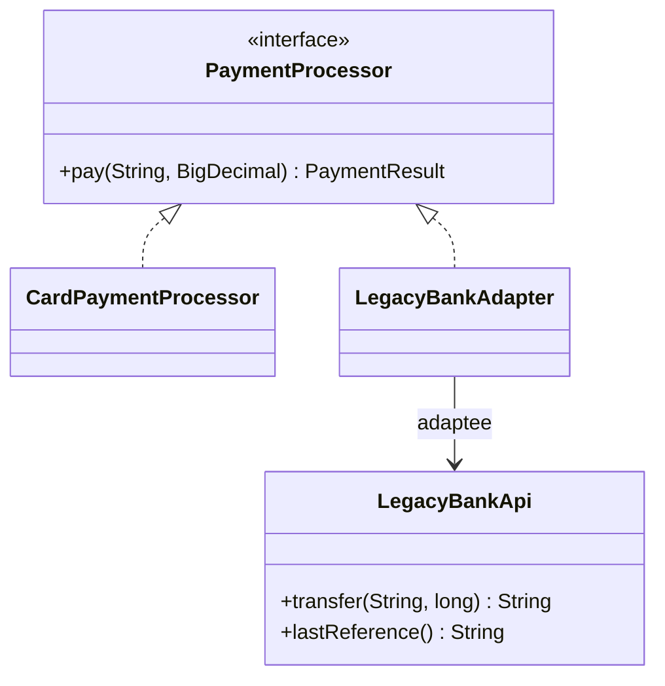

# Adapter (Adaptör)

> 🇬🇧 [English](../../en/structural/adapter.md) · **Kategori:** Yapısal (Structural) · **Kod:** [`structural/adapter`](../../../src/main/java/designpatterns/structural/adapter)

## Amaç

Bir sınıfın arayüzünü, istemcinin beklediği başka bir arayüze dönüştürmek. Adapter, **uyumsuz
arayüzler** yüzünden birlikte çalışamayan sınıfların birlikte çalışmasını sağlar.

## Problem

Ödeme kodumuz `PaymentProcessor.pay(customerId, BigDecimal amount)` ile çalışıyor. Entegre olmamız
gereken banka ise eski (legacy) bir API sunuyor: `transfer(String accountNo, long amountInCents)` ve
`"00"`, `"51"` gibi durum kodları döndürüyor. Bankanın koduna dokunamayız ve bankaya özgü
detayların ödeme koduna sızmasını istemeyiz.

## Çözüm

İstemcinin beklediği arayüzü uygulayan ve içeride eski API'yi çağıran bir **adapter** yaz;
parametreleri ve sonuçları dönüştürsün.



| Rol | Sınıf |
|---|---|
| Target (Hedef) | [`PaymentProcessor`](../../../src/main/java/designpatterns/structural/adapter/PaymentProcessor.java) |
| Adaptee (Uyarlanan) | [`LegacyBankApi`](../../../src/main/java/designpatterns/structural/adapter/LegacyBankApi.java) |
| Adapter | [`LegacyBankAdapter`](../../../src/main/java/designpatterns/structural/adapter/LegacyBankAdapter.java) |
| Client (İstemci) | [`AdapterDemo`](../../../src/main/java/designpatterns/structural/adapter/AdapterDemo.java) |

```java
public PaymentResult pay(String customerId, BigDecimal amount) {
    long cents = amount.movePointRight(2).longValueExact();      // BigDecimal -> kuruş
    String status = bankApi.transfer("TR-" + customerId, cents);  // adaptee'yi çağır
    boolean success = "00".equals(status);                       // durum kodu -> boolean
    return new PaymentResult(success, success ? bankApi.lastReference() : null);
}
```

## Object adapter ve class adapter

- **Object adapter** (burada kullanılan) – adapter, adaptee'yi *içinde tutar* (kompozisyon).
  Adaptee'nin tüm alt sınıflarıyla çalışır, Java'da tercih edilen yöntemdir.
- **Class adapter** – adapter, adaptee'yi *extend eder* ve hedefi uygular. Sınıflarda çoklu kalıtım
  gerektirdiği için Java'da yalnızca hedef bir interface ise mümkündür.

## Ne zaman kullanılır?

- Arayüzü ihtiyacınıza uymayan mevcut bir sınıfı kullanmak istediğinizde.
- Üçüncü parti kütüphaneler, eski sistemler veya dış API'lerle entegrasyonda (anti-corruption layer).

## Artıları ve eksileri

| ✅ Artıları | ❌ Eksileri |
|---|---|
| İstemci kodu dış API'den yalıtılır | Fazladan bir sınıf/katman |
| Single Responsibility: dönüşüm mantığı tek yerde | Servis sizinse doğrudan onu değiştirmek daha basit olabilir |
| Open/Closed: istemciye dokunmadan yeni adapter'lar | |

## Gerçek dünyadan örnekler

- `java.util.Arrays.asList()` – dizi → `List`
- `java.io.InputStreamReader` – byte akışı → karakter akışı
- `java.util.Collections.enumeration()` / `list()` – `Iterator` ↔ `Enumeration`
- Spring MVC `HandlerAdapter`

## İlişkili kalıplar

- **Bridge** baştan tasarlanır; Adapter var olan şeyleri birlikte çalıştırmak için sonradan eklenir.
- **Decorator** arayüzü korur ve davranış ekler; Adapter arayüzü değiştirir.
- **Facade** bütün bir alt sistem için *yeni ve daha basit* bir arayüz tanımlar.
- **Proxy** aynı arayüzü korur.
