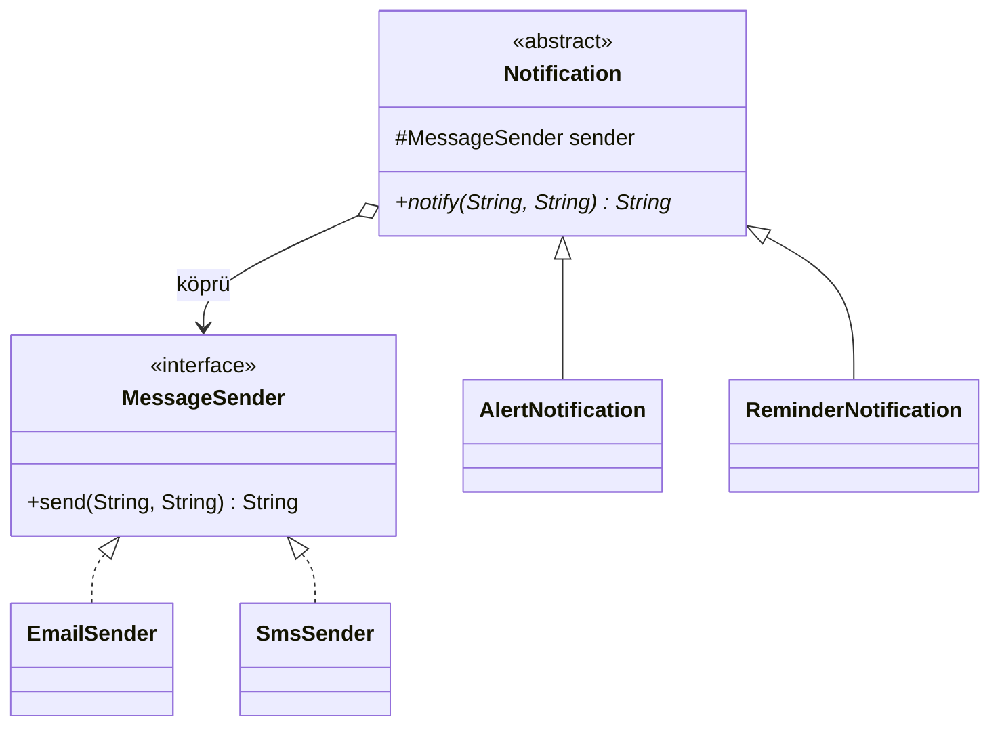

# Bridge (Köprü)

> 🇬🇧 [English](../../en/structural/bridge.md) · **Kategori:** Yapısal (Structural) · **Kod:** [`structural/bridge`](../../../src/main/java/designpatterns/structural/bridge)

## Amaç

**Soyutlamayı gerçekleştiriminden ayırmak**, böylece ikisinin birbirinden bağımsız olarak
değişebilmesini sağlamak.

## Problem

Bildirim gönderiyoruz. İki tür (uyarı, hatırlatma) ve iki kanal (e-posta, SMS) var. Kalıtımla
`AlertEmail`, `AlertSms`, `ReminderEmail`, `ReminderSms` sınıflarına ihtiyaç olur. Push bildirimi
eklemek sınıf sayısını yine katlar: hiyerarşi **tür × kanal** kadar büyür.

## Çözüm

Problemi iki hiyerarşiye böl ve onları kompozisyonla (köprü) bağla:

- **Abstraction (Soyutlama)** – *ne* gönderilecek: `Notification`, `AlertNotification`, `ReminderNotification`
- **Implementor (Gerçekleştirici)** – *nasıl* gönderilecek: `MessageSender`, `EmailSender`, `SmsSender`

Soyutlama bir implementor referansı tutar. Artık sınıf sayısı **tür + kanal** kadar büyür.



| Rol | Sınıf |
|---|---|
| Abstraction | [`Notification`](../../../src/main/java/designpatterns/structural/bridge/Notification.java) |
| Refined abstractions | [`AlertNotification`](../../../src/main/java/designpatterns/structural/bridge/AlertNotification.java), [`ReminderNotification`](../../../src/main/java/designpatterns/structural/bridge/ReminderNotification.java) |
| Implementor | [`MessageSender`](../../../src/main/java/designpatterns/structural/bridge/MessageSender.java) |
| Concrete implementors | [`EmailSender`](../../../src/main/java/designpatterns/structural/bridge/EmailSender.java), [`SmsSender`](../../../src/main/java/designpatterns/structural/bridge/SmsSender.java) |

```java
new AlertNotification(new SmsSender()).notify("cem", "server is down");
new ReminderNotification(new EmailSender()).notify("cem", "meeting in 10 minutes");
```

Örnek: [`BridgeDemo.java`](../../../src/main/java/designpatterns/structural/bridge/BridgeDemo.java)

## Ne zaman kullanılır?

- Bir sınıfın ayrı ayrı genişletilmesi gereken iki (veya daha fazla) bağımsız boyutu varsa.
- Gerçekleştirimi çalışma zamanında değiştirmek istiyorsanız.
- Kalıtımın yol açtığı "sınıf patlamasından" kaçınmak istiyorsanız.

## Artıları ve eksileri

| ✅ Artıları | ❌ Eksileri |
|---|---|
| Soyutlama ve gerçekleştirim bağımsız gelişir | Daha fazla dolaylılık, ilk bakışta anlaşılması zor |
| Her iki hiyerarşide de Open/Closed | Tek ve tutarlı bir sınıf için gereksiz |
| Platformdan bağımsız soyutlamalar | |

## Gerçek dünyadan örnekler

- **JDBC**: kodunuz `Connection`/`Statement` kullanır (soyutlama), her sürücü gerçekleştirimi sağlar.
- **SLF4J**: loglama API'si (soyutlama) Logback, Log4j2... (gerçekleştirim) ile köprülenir.
- `java.util.logging.Handler` ↔ `Formatter`

## İlişkili kalıplar

- **Adapter** ilgisiz sınıfları sonradan birlikte çalıştırmak için uygulanır; Bridge baştan tasarlanır.
- **Abstract Factory** belirli bir köprüyü oluşturup yapılandırabilir.
- **Strategy** benzer yapıdadır ama amacı iki hiyerarşiyi ayırmak değil, algoritma değiştirmektir.
