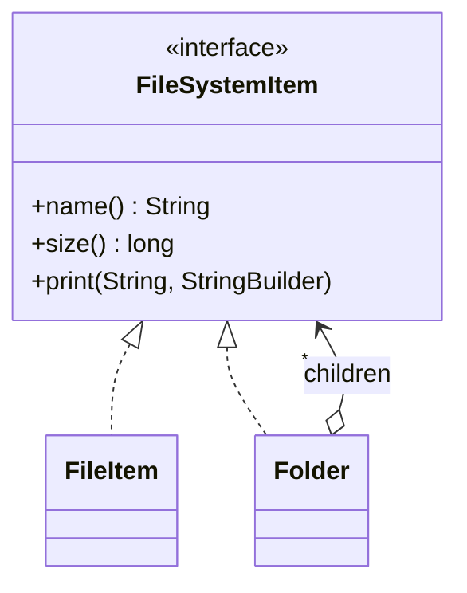

# Composite (Bileşik)

> 🇬🇧 [English](../../en/structural/composite.md) · **Kategori:** Yapısal (Structural) · **Kod:** [`structural/composite`](../../../src/main/java/designpatterns/structural/composite)

## Amaç

Parça-bütün hiyerarşilerini temsil etmek için nesneleri **ağaç yapıları** halinde birleştirmek.
Composite, istemcilerin tekil nesnelere ve nesne gruplarına **aynı şekilde** davranmasını sağlar.

## Problem

Bir dosya sisteminde dosyalar ve klasörler vardır; klasörler dosyaları *ve başka klasörleri* içerir.
Bir klasörün boyutunu hesaplamak için `instanceof` kontrolleri ve iç içe döngülerle dolu bir kod
gerekir; yeni bir düğüm türü geldiğinde bu kodun da güncellenmesi gerekir.

## Çözüm

Yapraklar (leaf) ve kapsayıcılar (container) için ortak bir arayüz (`FileSystemItem`) tanımla.
Kapsayıcı (`Folder`), bu arayüz tipinde çocuklar tutar ve işlemleri çocuklarına özyinelemeli
(recursive) olarak devrederek gerçekleştirir. İstemci, bir dosyayla mı yoksa bütün bir ağaçla mı
çalıştığını umursamadan `size()` çağırır.



| Rol | Sınıf |
|---|---|
| Component (Bileşen) | [`FileSystemItem`](../../../src/main/java/designpatterns/structural/composite/FileSystemItem.java) (sealed interface) |
| Leaf (Yaprak) | [`FileItem`](../../../src/main/java/designpatterns/structural/composite/FileItem.java) (record) |
| Composite (Bileşik) | [`Folder`](../../../src/main/java/designpatterns/structural/composite/Folder.java) |

```java
@Override
public long size() {
    return children.stream().mapToLong(FileSystemItem::size).sum(); // özyineleme
}
```

Örnek: [`CompositeDemo.java`](../../../src/main/java/designpatterns/structural/composite/CompositeDemo.java)

## Şeffaflık mı, güvenlik mi?

`add()`/`remove()` nerede tanımlanmalı?

- **Component** içinde (şeffaf): istemci her şeye aynı davranır ama yaprakta `add()` çağrısı
  exception fırlatmak zorundadır.
- Sadece **composite** içinde (güvenli, burada kullanılan): tip güvenlidir ama istemcinin
  composite ile çalıştığını bilmesi gerekir.

## Ne zaman kullanılır?

- Bir ağaç temsil etmeniz gerekiyorsa: menüler, dosya sistemleri, organizasyon şemaları, UI
  bileşenleri, ifade ağaçları, ürün paketleri.
- İstemciler tekil nesne ile grup arasındaki farkı görmezden gelmeliyse.

## Artıları ve eksileri

| ✅ Artıları | ❌ Eksileri |
|---|---|
| Polimorfizm ve özyineleme sayesinde basit istemci kodu | Ortak arayüz fazla genel hale gelebilir |
| Yeni düğüm türü eklemek kolay (Open/Closed) | Bir composite'in hangi çocukları kabul edeceğini kısıtlamak zor |

## Gerçek dünyadan örnekler

- `java.awt.Container` / `Component`, JavaFX `Parent` / `Node`
- HTML DOM, JSON / XML ağaçları
- `javax.faces.component.UIComponent`

## İlişkili kalıplar

- **Iterator** bir composite'i dolaşabilir; **Visitor** tüm düğümlere işlem uygulayabilir.
- **Decorator** benzer görünür (özyinelemeli kompozisyon) ama tek çocuğu vardır ve davranış ekler.
- Paylaşılan yaprak düğümler için **Flyweight** kullanılabilir.
- Karmaşık composite ağaçları oluşturmak için **Builder** faydalıdır.
