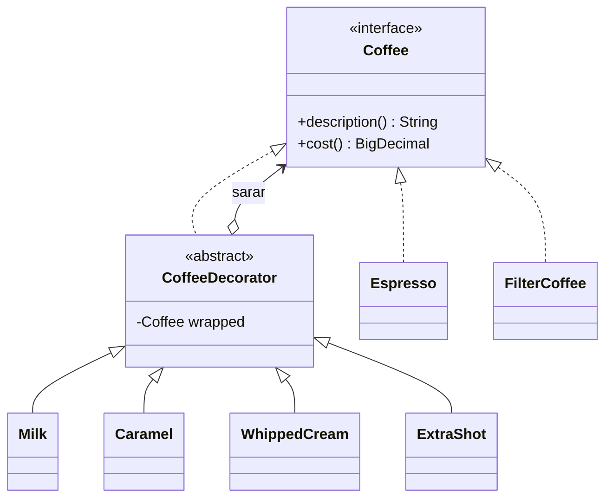

# Decorator (Dekoratör)

> 🇬🇧 [English](../../en/structural/decorator.md) · **Kategori:** Yapısal (Structural) · **Kod:** [`structural/decorator`](../../../src/main/java/designpatterns/structural/decorator)

## Amaç

**Bir nesneye çalışma zamanında dinamik olarak ek sorumluluklar eklemek.** Decorator, işlevselliği
genişletmek için alt sınıf oluşturmaya esnek bir alternatif sunar.

## Problem

Bir kahve dükkânı espresso ve filtre kahve satıyor; isteğe göre süt, karamel, krema ve ekstra shot
eklenebiliyor. Her kombinasyon için bir alt sınıf (`EspressoWithMilkAndCaramel`...) yazmak sınıf
sayısını patlatır ve çalışma zamanında değiştirilemez.

## Çözüm

Nesneyi, **aynı arayüzü** uygulayan dekoratör nesnelerle sar. Her dekoratör sardığı nesneyi tutar,
çağrıyı ona iletir ve öncesinde/sonrasında kendi davranışını ekler. Dekoratörler istenen sırada ve
sayıda üst üste eklenebilir.



| Rol | Sınıf |
|---|---|
| Component (Bileşen) | [`Coffee`](../../../src/main/java/designpatterns/structural/decorator/Coffee.java) |
| Concrete components | [`Espresso`](../../../src/main/java/designpatterns/structural/decorator/Espresso.java), [`FilterCoffee`](../../../src/main/java/designpatterns/structural/decorator/FilterCoffee.java) |
| Base decorator | [`CoffeeDecorator`](../../../src/main/java/designpatterns/structural/decorator/CoffeeDecorator.java) |
| Concrete decorators | `Milk`, `Caramel`, `WhippedCream`, `ExtraShot` |

```java
Coffee coffee = new Caramel(new Milk(new Espresso()));
coffee.description(); // "Espresso + milk + caramel"
coffee.cost();        // 60.00 + 12.50 + 15.00 = 87.50
```

Örnek: [`DecoratorDemo.java`](../../../src/main/java/designpatterns/structural/decorator/DecoratorDemo.java)

Önce / sonra: [refactoring örneği](../refactoring.md#decorator)

## Ne zaman kullanılır?

- Diğer nesneleri etkilemeden, tekil nesnelere çalışma zamanında sorumluluk eklemek gerekiyorsa.
- Alt sınıflarla genişletme pratik değilse (çok fazla kombinasyon) veya mümkün değilse (`final` sınıf).
- Kesişen ilgiler (cross-cutting concerns): loglama, önbellek, retry, sıkıştırma, şifreleme, metrikler.

## Artıları ve eksileri

| ✅ Artıları | ❌ Eksileri |
|---|---|
| Davranışları çalışma zamanında birleştirme | Çok sayıda küçük nesne, debug etmek zor |
| Single Responsibility: her dekoratör tek özellik | Sarma sırası önemlidir |
| Alt sınıf patlaması yok | Yığının ortasından belirli bir dekoratörü çıkarmak zor |

## Gerçek dünyadan örnekler

- **java.io**: `new BufferedReader(new InputStreamReader(new FileInputStream(file)))`
- `Collections.unmodifiableList()`, `Collections.synchronizedMap()`, `Collections.checkedList()`
- Spring `TransactionAwareDataSourceProxy`, servlet `HttpServletRequestWrapper`

## İlişkili kalıplar

- **Adapter** arayüzü değiştirir; Decorator arayüzü korur ve davranışı zenginleştirir.
- **Proxy** aynı yapıdadır ama erişimi kontrol eder; proxy genellikle nesnenin yaşam döngüsünü
  yönetir, dekoratörleri ise istemci birleştirir.
- **Composite** – dekoratör, tek çocuğu olan bir composite gibidir.
- **Strategy** nesnenin "içini", Decorator ise "dışını" değiştirir.
