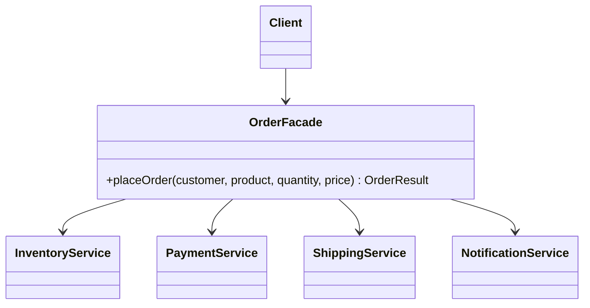

# Facade (Cephe)

> 🇬🇧 [English](../../en/structural/facade.md) · **Kategori:** Yapısal (Structural) · **Kod:** [`structural/facade`](../../../src/main/java/designpatterns/structural/facade)

## Amaç

Bir alt sistemdeki arayüzler kümesine **tek ve basit bir arayüz** sağlamak. Facade, alt sistemin
kullanımını kolaylaştıran üst seviye bir arayüz tanımlar.

## Problem

Sipariş vermek için dört servisin doğru sırada ve doğru hata yönetimiyle çağrılması gerekir:
stok kontrolü → ödeme → stok ayırma → kargo oluşturma → e-posta gönderme. Her controller bunu kendi
yaparsa mantık tekrarlanır ve her istemci dört servise birden bağımlı olur.

## Çözüm

Alt sistemi koordine eden tek metotlu (`placeOrder(...)`) bir **facade** sınıfı oluştur. İstemciler
yalnızca facade ile konuşur. Gelişmiş özelliklere ihtiyaç duyan istemciler alt sistem sınıflarını
yine doğrudan kullanabilir.



| Rol | Sınıf |
|---|---|
| Facade | [`OrderFacade`](../../../src/main/java/designpatterns/structural/facade/OrderFacade.java) |
| Alt sistem | [`InventoryService`](../../../src/main/java/designpatterns/structural/facade/InventoryService.java), [`PaymentService`](../../../src/main/java/designpatterns/structural/facade/PaymentService.java), [`ShippingService`](../../../src/main/java/designpatterns/structural/facade/ShippingService.java), [`NotificationService`](../../../src/main/java/designpatterns/structural/facade/NotificationService.java) |

```java
OrderResult result = shop.placeOrder("cem", "BOOK-1", 2, new BigDecimal("150"));
```

Örnek: [`FacadeDemo.java`](../../../src/main/java/designpatterns/structural/facade/FacadeDemo.java)

## Ne zaman kullanılır?

- Karmaşık bir alt sisteme veya kütüphaneye basit bir giriş noktası istiyorsanız.
- Sisteminizi katmanlara ayırmak istiyorsanız (her katman bir sonrakiyle facade üzerinden konuşur).
- İstemciler ile çok sayıda alt sistem sınıfı arasındaki bağlılığı azaltmak istiyorsanız.

## Artıları ve eksileri

| ✅ Artıları | ❌ Eksileri |
|---|---|
| Karmaşıklığı gizler, basit API | Her şeye bağlı bir "god object"e dönüşebilir |
| İstemciler alt sistem detaylarından bağımsızdır | Bazı istemcilerin ihtiyaç duyduğu özellikleri gizleyebilir |
| Alt sistem, istemcileri bozmadan değişebilir | |

## Gerçek dünyadan örnekler

- Spring uygulamalarındaki **servis katmanı** (repository'leri ve client'ları koordine eden `OrderService`)
- `javax.faces.context.FacesContext`
- `java.net.URL.openStream()` soketleri, protokolleri ve handler'ları gizler
- SLF4J'nin `LoggerFactory`'si loglama gerçekleştirimleri üzerinde bir facade'dır

## İlişkili kalıplar

- **Adapter** var olan tek bir arayüzü kullanılabilir hale getirir; Facade *çok sayıda* nesne için
  yeni ve daha basit bir arayüz tanımlar.
- **Mediator** da nesneleri koordine eder ama meslektaşlar (colleague) mediator'ı bilir ve onun
  üzerinden iletişim kurar; alt sistem sınıfları ise facade'ın varlığından habersizdir.
- Facade genellikle **Singleton**'dır.
- Alt sistem nesnelerinin nasıl oluşturulduğunu gizlemek için **Abstract Factory** ile birlikte kullanılabilir.
