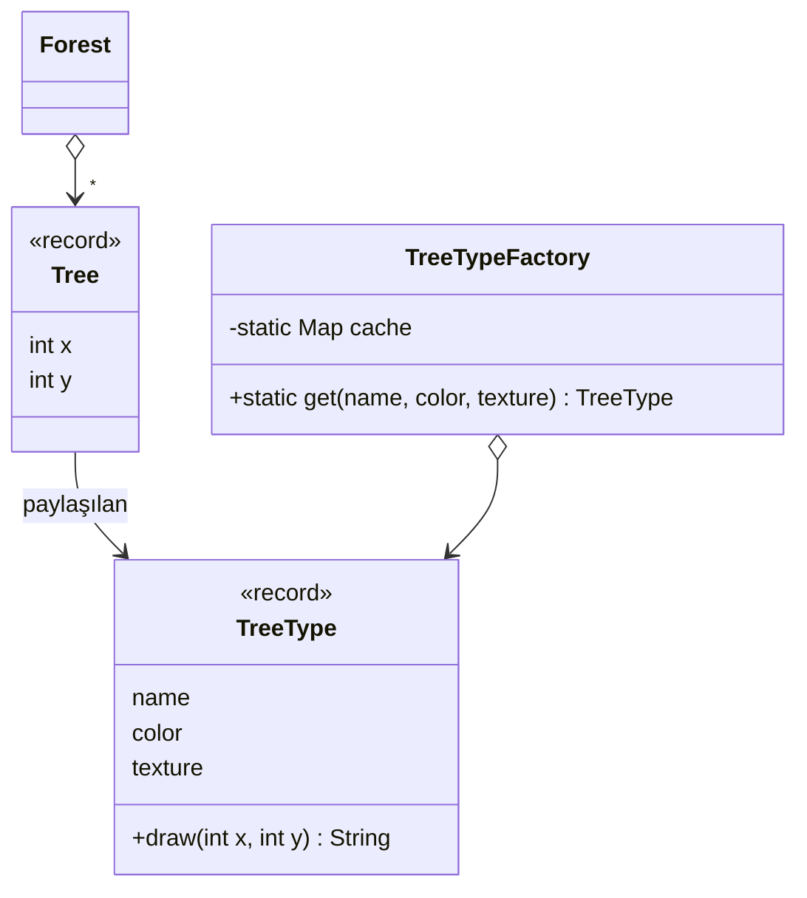

# Flyweight (Sinek Siklet)

> 🇬🇧 [English](../../en/structural/flyweight.md) · **Kategori:** Yapısal (Structural) · **Kod:** [`structural/flyweight`](../../../src/main/java/designpatterns/structural/flyweight)

## Amaç

Çok sayıda küçük nesneyi verimli şekilde desteklemek için **paylaşımı** kullanmak.

## Problem

Bir oyun 100 000 ağaçtan oluşan bir orman çiziyor. Her ağacın bir konumu, ayrıca adı, rengi ve
megabaytlarca tutan bir dokusu (texture) var. Her ağaç kendi dokusunu tutarsa bellek biter — oysa
yalnızca üç çeşit ağaç var.

## Çözüm

Nesnenin durumunu ikiye ayır:

- **İç durum (intrinsic state)** – paylaşılan, değişmez, birçok nesne için aynı (ad, renk, doku)
  → **flyweight** içinde tutulur (`TreeType`).
- **Dış durum (extrinsic state)** – her nesneye özgü (x, y) → bağlam nesnesinde (`Tree`) tutulur
  veya metotlara parametre olarak geçirilir.

Bir **flyweight factory**, flyweight'leri önbellekte tutar ve tekrar istendiğinde mevcut olanı döndürür.

| Rol | Sınıf |
|---|---|
| Flyweight | [`TreeType`](../../../src/main/java/designpatterns/structural/flyweight/TreeType.java) |
| Flyweight factory | [`TreeTypeFactory`](../../../src/main/java/designpatterns/structural/flyweight/TreeTypeFactory.java) |
| Context (Bağlam) | [`Tree`](../../../src/main/java/designpatterns/structural/flyweight/Tree.java) |
| Client (İstemci) | [`Forest`](../../../src/main/java/designpatterns/structural/flyweight/Forest.java) |

Örneğin sonucu: **100 000** `Tree` nesnesi, ama bellekte yalnızca **3** `TreeType` nesnesi.

Örnek: [`FlyweightDemo.java`](../../../src/main/java/designpatterns/structural/flyweight/FlyweightDemo.java)

## Ne zaman kullanılır?

- Uygulama çok sayıda benzer nesne kullanıyor ve bellek bir sorunsa.
- Nesne durumunun büyük kısmı dışsal hale getirilebiliyorsa.
- Nesne kimliği (identity) önemli değilse (paylaşılan nesneler değişmez olmalıdır).

## Artıları ve eksileri

| ✅ Artıları | ❌ Eksileri |
|---|---|
| Ciddi RAM tasarrufu | Kod daha karmaşık hale gelir |
| | Bellek yerine CPU harcanır (dış durum hesaplanmalı/geçirilmeli) |
| | Flyweight'ler değişmez olmalı; factory thread safe olmalı |

## Gerçek dünyadan örnekler

- `Integer.valueOf()` -128..127 aralığını önbellekte tutar (`Long`, `Short`, `Byte`, `Character`, `Boolean` da)
- **String pool** / `String.intern()`
- Metin editörlerindeki glifler, oyunlardaki karolar (tile)

## İlişkili kalıplar

- **Composite** yaprak düğümleri flyweight olarak yazılabilir.
- **Singleton** benzerdir ama tek nesne vardır; flyweight'lerde *her iç durum için* bir nesne vardır
  ve bunlar değişmezdir.
- Flyweight'leri elde etmek için **Factory Method** / basit fabrikalar kullanılır.
