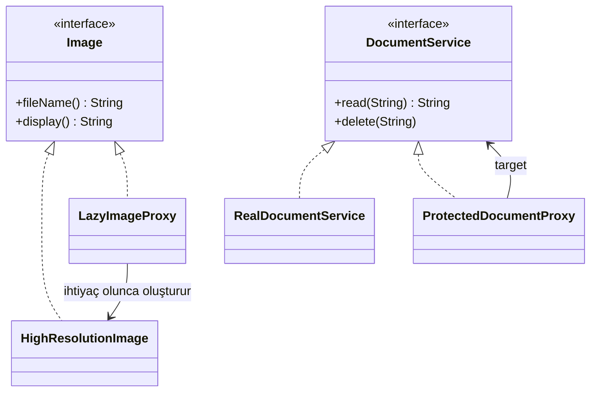

# Proxy (Vekil)

> 🇬🇧 [English](../../en/structural/proxy.md) · **Kategori:** Yapısal (Structural) · **Kod:** [`structural/proxy`](../../../src/main/java/designpatterns/structural/proxy)

## Amaç

Başka bir nesneye **erişimi kontrol etmek** için onun yerine geçen bir **vekil (temsilci)** nesne sağlamak.

## Problem

- Bir galeri 100 küçük resim gösteriyor ama açılışta bütün yüksek çözünürlüklü resimleri yüklemek
  saniyeler sürüyor ve çok bellek harcıyor — çoğu hiç açılmayacak bile.
- Bir doküman servisi yetki kontrolü yapmalı ve denetim kaydı (audit log) tutmalı, ama güvenlik
  kodunu servisin içine karıştırmak istemiyoruz.

## Çözüm

Gerçek nesneyle **aynı arayüzü** uygulayan bir proxy oluştur. İstemci farkı anlayamaz. Proxy, gerçek
nesneye ne zaman ve gerçekten devredilip devredilmeyeceğine karar verir; öncesinde/sonrasında ek iş
yapabilir.

| Proxy türü | Sınıf | Ne yapar? |
|---|---|---|
| Virtual proxy | [`LazyImageProxy`](../../../src/main/java/designpatterns/structural/proxy/LazyImageProxy.java) | Pahalı nesneyi ilk kullanımda oluşturur |
| Protection proxy | [`ProtectedDocumentProxy`](../../../src/main/java/designpatterns/structural/proxy/ProtectedDocumentProxy.java) | Rolü kontrol eder, audit log yazar |

Örnek: [`ProxyDemo.java`](../../../src/main/java/designpatterns/structural/proxy/ProxyDemo.java)

## Proxy türleri

| Tür | Amaç | Örnek |
|---|---|---|
| Virtual (Sanal) | Ağır nesnenin geç başlatılması | Hibernate lazy loaded entity'ler |
| Protection (Koruma) | Erişim kontrolü | Spring Security metot güvenliği |
| Remote (Uzak) | Başka bir adres alanındaki nesneyi temsil eder | Java RMI stub'ları, gRPC/Feign client'ları |
| Caching (Önbellek) | Önbellekteki sonucu döndürür | Spring `@Cacheable` |
| Logging / Smart reference | Loglama, referans sayma, kilitleme | Spring `@Transactional` |

## Ne zaman kullanılır?

- Lazy loading, erişim kontrolü, loglama, önbellek veya uzak erişim **şeffaf** şekilde eklenecekse.

## Artıları ve eksileri

| ✅ Artıları | ❌ Eksileri |
|---|---|
| İstemci farkında olmadan gerçek nesne kontrol edilir | Fazladan katman, gecikme ekleyebilir |
| Open/Closed: servisi değiştirmeden yeni proxy'ler | Daha fazla sınıf (dinamik proxy kullanılmazsa) |
| Gerçek nesne hazır/erişilebilir olmasa da çalışır | |

## Gerçek dünyadan örnekler

- `java.lang.reflect.Proxy` – çalışma zamanında oluşturulan **dinamik proxy'ler**
- Spring AOP: `@Transactional`, `@Cacheable`, `@Async` JDK/CGLIB proxy'leriyle çalışır
- Hibernate lazy loading proxy'leri, `Collections.unmodifiableList()` (aynı zamanda bir koruma proxy'si)

## İlişkili kalıplar

- **Adapter** farklı bir arayüz, Proxy aynı arayüz, **Decorator** zenginleştirilmiş bir arayüz sunar.
- Decorator ve Proxy aynı yapıdadır; Proxy genellikle nesnenin yaşam döngüsünü yönetir,
  dekoratörleri istemci birleştirir.
- **Facade** da karmaşık bir yapının önünde durması bakımından proxy'ye benzer ama arayüzü farklıdır.
